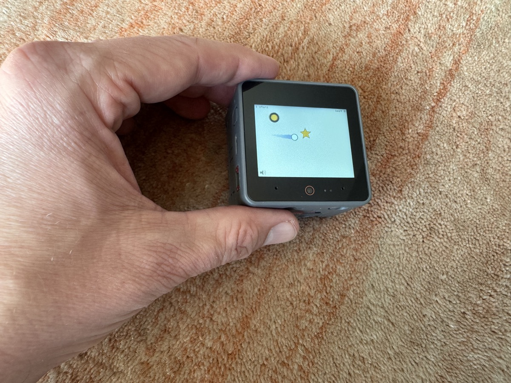
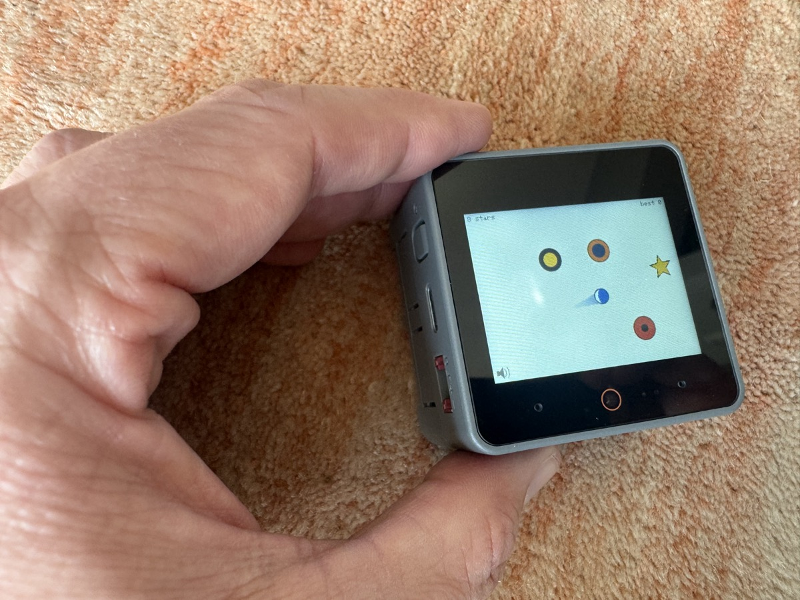
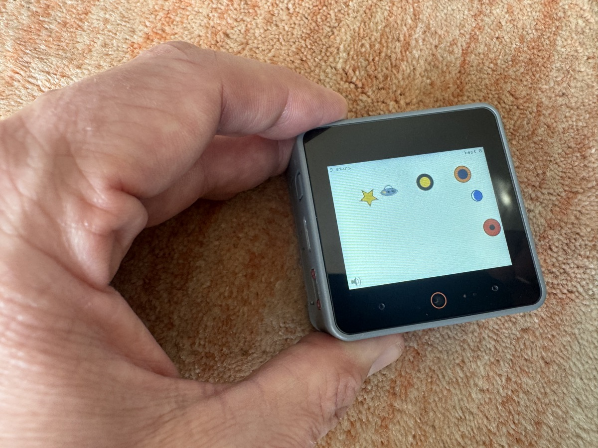
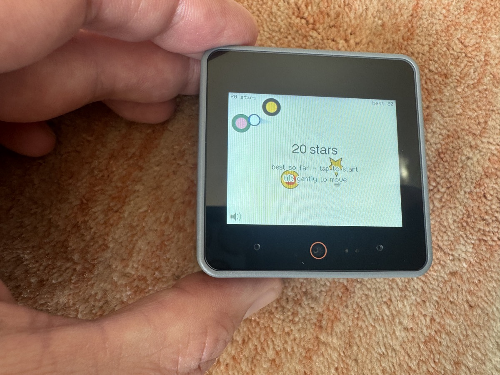

# Inertia

A small tilt game for the [M5Stack CoreS3](https://docs.m5stack.com/en/core/CoreS3). Lay the device flat, tip it gently, and roll a little moon into the stars without getting hit by the heavy coloured discs sliding around with you.

<p>
  
  
  
  
</p>

## The idea

When you tilt the device, *everything* on screen feels it, not just you.

- **You are the moon.** It is light, so it speeds up quickly and stops quickly.
- **The coloured discs are weights.** They are heavy, so they are slow to get going and slow to stop.

Every tilt that moves you towards a star also sets the weights sliding. The game is about getting where you want to go without sloshing a weight into yourself.

## What you need

- An M5Stack CoreS3.
- The **M5Unified** library (installing it also brings in M5GFX).

Flash `Inertia.ino` to the device as you would any other sketch. Nothing needs to be configured: no Wi-Fi, no accounts.

## How to play

1. **Lay the device flat** on a table, screen up, or hold it flat like a tray. The game does not work held upright.
2. **Tap the screen** to start a run.
3. **Tilt gently** to roll the moon. A thin line from the moon shows which way the tilt is pushing and how hard.
4. **Roll into the yellow star** to score. A new star appears somewhere else.
5. **Don't touch a weight.** That ends the run. Tap to start again.

### Things you will meet

| | |
|---|---|
| **Star** | Worth one point. The moon has to be well inside it to count. |
| **Weight** | A coloured disc with a dot in the centre. A bigger dot means a heavier, more sluggish weight. Weights bounce off the edges and off each other. |
| **Warning triangle** | A new weight arrives every 4 stars, up to 6 in total. A blinking triangle marks where it will land. It can't hurt you until it turns solid, about a second and a half later, so move away. |
| **Flying saucer** | Once there are at least two weights, a saucer crosses the screen every 20 to 30 seconds. Catch it and it removes the weight nearest to you. |

### Controls

| Action | What it does |
|---|---|
| Tap | Start a run |
| Tap the speaker icon (bottom left) | Step the sound: off, normal, loud. The choice is remembered. |
| Press and hold | Re-set what counts as "level" (see below) |

Your score and the best score since power-on are shown along the top. The best score is forgotten when the device is switched off.

## Tips

- Small tilts are enough. A big tilt gets the weights moving fast, and they take a long time to stop.
- The moon stops much sooner than the weights, so you can dodge by levelling out and letting them slide past.
- Listen to the star chime. It climbs with each star, and the fourth one has a warning under it: a new weight is coming.
- Heading for the saucer is worth a detour when a weight is crowding you, because it takes the nearest one.

## If the moon drifts on its own

The game measures "level" when the device powers on, so switch it on while it is lying flat. If the moon still drifts (a sloping desk, for example), leave the device flat and **press and hold** the screen until it says "level set".

This only works when the device is within about 9 degrees of flat. Otherwise it says "lay it flat to set level" and changes nothing.

## Changing the game

All the numbers that shape the game are at the top of `Inertia.ino` under **Settings**, each with a comment. Some good ones to try first:

| Setting | What it changes |
|---|---|
| `PUCK_ACCEL`, `PUCK_DRAG` | How quickly the moon speeds up and how soon it stops |
| `WEIGHT_ACCEL_MIN`, `WEIGHT_ACCEL_MAX` | How heavy the weights are (lower is heavier) |
| `STARS_PER_WEIGHT`, `MAX_WEIGHTS` | How fast the game gets harder, and how hard it gets |
| `TILT_FULL`, `TILT_DEADZONE` | How far you have to tilt for full push, and how much tilt is ignored |
| `SAUCER_WAIT_MIN`, `SAUCER_WAIT_MAX` | How often the saucer visits |
| `SOUND_VOLUMES` | Loudness of the off, normal and loud steps |

Change a number, flash again, and see how it feels.

## Changing the sounds

The sound effects are retro 8-bit samples made by a Python script. It needs Python 3 and nothing else. From this folder:

```bash
python3 tools/make_sounds.py
```

This rewrites `sounds.h` (the samples built into the sketch) and puts WAV copies in `tools/preview/` so you can listen on your computer before flashing. To change a sound, edit its recipe in `tools/make_sounds.py` and run the script again. Don't edit `sounds.h` by hand; the script overwrites it.

## Files

| File | What it is |
|---|---|
| `Inertia.ino` | The game |
| `sounds.h` | The sound samples, generated by the script |
| `tools/make_sounds.py` | Makes the sounds |
| `tools/preview/` | WAV copies of the sounds |
| `screenshots/` | The photos above |
